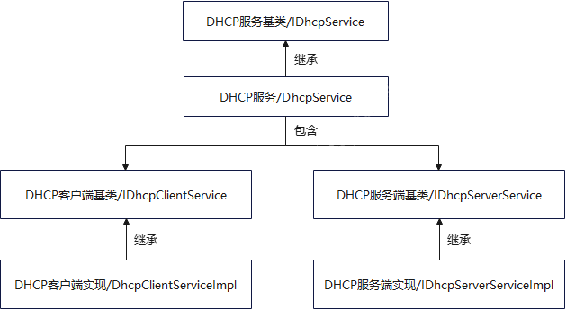

# communication_dhcp

#### Description
Dynamic Host Configuration Protocol (DHCP) is a standard protocol defined by RFC 1541 that allows servers to dynamically assign IP addresses and configuration information to clients. The DHCP protocol supports C/S (client/server) structure, which mainly includes two parts:

1. DHCP client: it is usually mobile phones, PCs, printers and other terminal devices in the network, using the IP information assigned from the DHCP server, including IP address, default gateway and DNS.

2. DHCP server: used to manage all IP network information, and process the client's DHCP request, assigning IP address, subnet mask, default gateway and other content to the accessing client.

-   C APIs: C APIs of the DHCP client are provided to register callbacks and to start and stop the client, so that upper-layer modules can call them from C code.
-   System service: the DHCP client is registered with SAMGR as a system service, so that other subsystems can obtain it by service name.
-   Automatic route and DNS configuration: after an IPv4 address is obtained, the default route is added and the DNS configuration is written automatically.
-   Synchronous task with timeout: a synchronous task API with a timeout is provided, which returns an error code on timeout.

#### Software Architecture
Software architecture description:
As shown in the figure below, the DhcpService class provides an interface for external management of DHCP module services, including start, stop and result acquisition of DHCP client services. start, stop and management of address pools and lease tables on the DHCP server, etc., which is convenient for calling the interface of DhcpService services in other subsystem business implementations.

#### Instructions

1. Call the class DhcpServiceAPI to get the IDhcpService instance;
2. Start DHCP function (Client/Server) through IDhcpService instance;
3. The client registers the callback of the DhcpResultNotify class through GetDhcpResult;

#### Related project

communication_wifi
