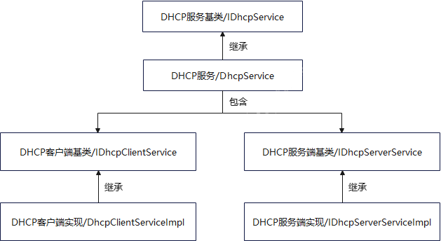

# communication_dhcp

#### Description
Dynamic Host Configuration Protocol (DHCP) is a standard protocol defined by RFC 1541 that allows servers to dynamically assign IP addresses and configuration information to clients. The DHCP protocol supports C/S (client/server) structure, which mainly includes two parts:

1. DHCP client: it is usually mobile phones, PCs, printers and other terminal devices in the network, using the IP information assigned from the DHCP server, including IP address, default gateway and DNS.

2. DHCP server: used to manage all IP network information, and process the client's DHCP request, assigning IP address, subnet mask, default gateway and other content to the accessing client.

#### Software Architecture
Software architecture description:
As shown in the figure below, the DhcpService class provides an interface for external management of DHCP module services, including start, stop and result acquisition of DHCP client services. start, stop and management of address pools and lease tables on the DHCP server, etc., which is convenient for calling the interface of DhcpService services in other subsystem business implementations.

#### Instructions

1. Call the class DhcpServiceAPI to get the IDhcpService instance;
2. Start DHCP function (Client/Server) through IDhcpService instance;
3. The client registers the callback of the DhcpResultNotify class through GetDhcpResult;

## Changes in This Release

This repository is adapted for the HiSpark AiFly (Hi3403V100) development board. For clarity, the changes are described in two parts: **Added Features** and **Enhanced Existing Features**.

### Added Features

1. Added DHCP Lite client C APIs
    -   Added `interfaces/kits/c/dhcp_lite_c_client_api.h`, exposing `RegisterDhcpClientCallBack`, `DealWifiDhcpCache`, `StartDhcpClient`, and `StopDhcpClient` through `extern "C"`.
    -   Added the implementation `frameworks/native/c_adapter/src/dhcp_lite_c_client_api.cpp`: it forwards to the existing C++ APIs via `DhcpClient::GetInstance(DHCP_CLIENT_ABILITY_ID)`; `StopDhcpClient` calls `UnRegisterCallBack` after success; parameters are null-checked via `CHECK_PTR_RETURN`.

2. Added the DHCP client system service (for small systems)
    -   Added `services/dhcp_client/include/dhcp_client_mgr_service_lite.h`: `DhcpClientMgrService` inherits from `Service`, with a singleton `GetInstance()` and implementations of `GetIdentity`, `GetServiceName`, `ServiceInitialize`, `ServiceMessageHandle`, and `GetServiceTaskConfig`.
    -   Added the implementation `services/dhcp_client/src/dhcp_client_mgr_service_lite.cpp`: it registers itself with `SAMGR_GetInstance()` via `SYSEX_SERVICE_INIT(Init)`; the service name is `DHCP_CLIENT_LITE`, and the task config is LEVEL_HIGH, PRI_NORMAL, stack 1024, queue 20, single task.

3. Added automatic default route and DNS persistence
    -   Added the static functions `ExecRouteAdd` (`fork` + `execl("/bin/route", ...)` to add the default gateway), `WriteResolvConf` (writes `/etc/resolv.conf`), and `SaveDefaultRouteAndDns` under the `OHOS_ARCH_LITE` branch of `services/dhcp_client/src/dhcp_client_service_impl.cpp`.
    -   `SaveDefaultRouteAndDns` is invoked after an IPv4 result succeeds (`DhcpIpv4ResultSuccess`), applying the gateway and DNS automatically.

4. Added a synchronous timed task API
    -   Added `PostSyncTimeOutTask` in `services/utils/src/dhcp_thread.cpp`, which runs a task with `std::packaged_task` and `std::future` and returns `ERROR_TIMEOUT` on timeout.

5. Added build and compilation integration
    -   Root `BUILD.gn`: adds `$DHCP_ROOT_DIR/frameworks/native:dhcp_client_sdk` to deps under `ohos_lite`.
    -   `services/dhcp_client/BUILD.gn`: adds `dhcp_result_store_manager.cpp`, `dhcp_thread.cpp`, `dhcp_client_feature_lite.cpp`, and `dhcp_client_mgr_service_lite.cpp` to sources, and adds the corresponding include paths and the `services/utils:dhcp_utils` dependency.
    -   `services/utils/BUILD.gn`: adds `dhcp_permission_utils.cpp` to sources, and adds the bounds_checking_function and hilog headers and dependencies.

### Enhanced Existing Features

1. The existing DHCP Lite client proxy (`DhcpClientProxy`) is enhanced
    -   Original functionality: obtains the client feature API through SAMGR and forwards requests such as callback registration and DHCP start/stop.
    -   Enhancement: adds `Initialize()`, which retries up to 30 times with a 300 ms interval while the feature is not ready, and `DhcpClientImpl::Init` now uses it. Return codes are unified to `DHCP_E_*` / `DHCP_SUCCESS` / `DHCP_FAILED`, and the missing `StopClientSa` / `IsRemoteDied` implementations and required headers are added.

2. The existing callback stub (`DhcpClientCallBackStub`) deserialization is hardened
    -   Original functionality: parses IPC data and invokes the upper-layer IP success/failure callbacks.
    -   Enhancement: extracts `ReadStringValue`, `ReadDhcpResultBase`, and `ReadDhcpResultStrings` to reuse the parsing logic, and adds a null check for `data` in `RemoteOnIpSuccessChanged`; pointer casts are changed from `static_cast` to `reinterpret_cast`; the stub adds the `callbackMutex_` member and the `<mutex>` header, fixing the failure to compile libdhcp_client_sdk on small systems.

3. The existing client stub (`dhcp_client_stub_lite.cpp`) is adjusted
    -   Original functionality: parses requests on the service side and calls the corresponding handlers.
    -   Enhancement: `OnStartDhcpClient` removes a redundant `ReadRemoteObject` read and adds the `config.ifname` / `config.bssid` assignments; `OnStopDhcpClient` also removes the redundant `ReadRemoteObject`; string-read pointer casts are changed to `reinterpret_cast`.

4. The existing server implementation (`dhcp_server_impl.cpp`) is corrected
    -   Original functionality: initializes the DHCP server proxy and caches the client handle on small systems.
    -   Enhancement: fixes the erroneous use of the `clientProxy` variable during initialization by switching to `serverProxy` and removing a redundant null check, avoiding abnormal initialization when the proxy is null.

5. The existing event result copy (`dhcp_event.cpp`) is hardened
    -   Original functionality: copies the address information from the DHCP result into the extension structure.
    -   Enhancement: skips empty strings when copying DNS addresses and logs them, avoiding invalid DNS addresses.

6. The existing client feature (`dhcp_client_feature_lite.cpp`) is adjusted
    -   Original functionality: provides the message handling entry of the DHCP client feature.
    -   Enhancement: log macros change from `LOGI`/`LOGE` to `DHCP_LOGI`/`DHCP_LOGE` with a new `DEFINE_DHCPLOG_DHCP_LABEL`; the feature instance type is corrected (`DhcpServerFeature` → `DhcpClientFeature`).

7. The existing IPC Lite adapter header (`dhcp_ipc_lite_adapter.h`) is completed
    -   Adds `#include "ipc_skeleton.h"` so that Lite IPC symbols are visible.

#### Related project

communication_wifi
